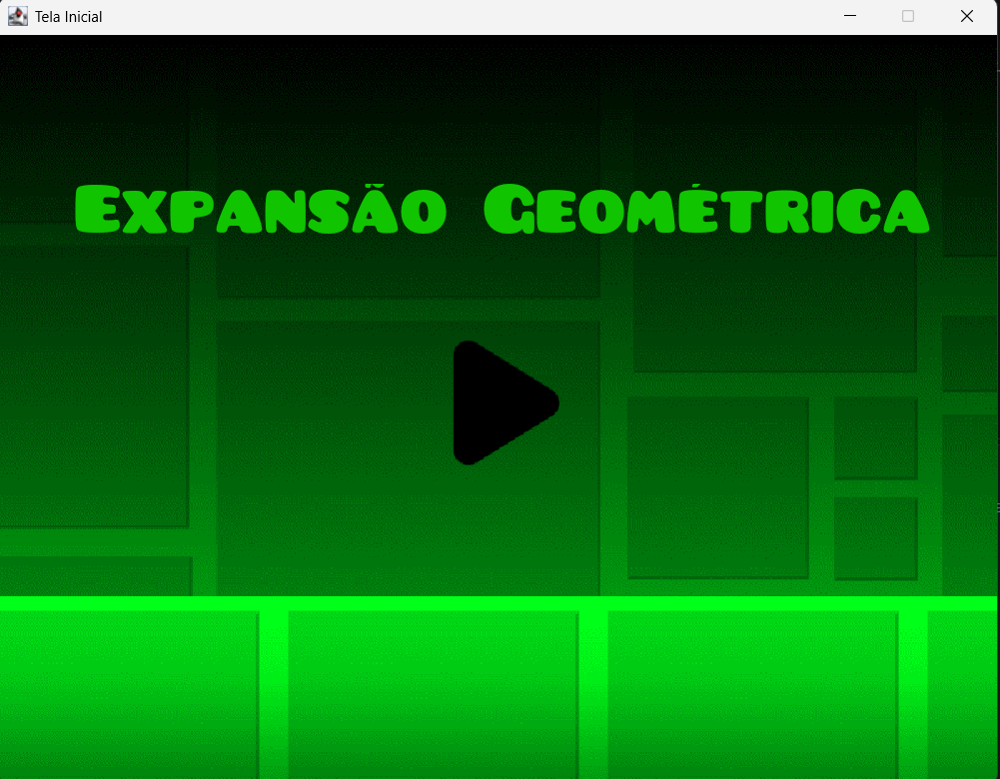
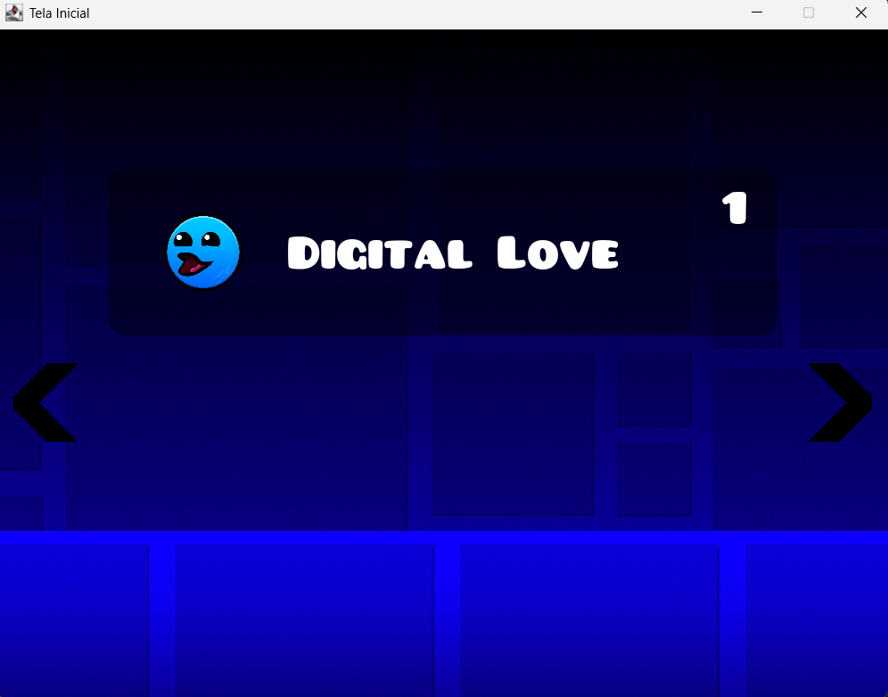
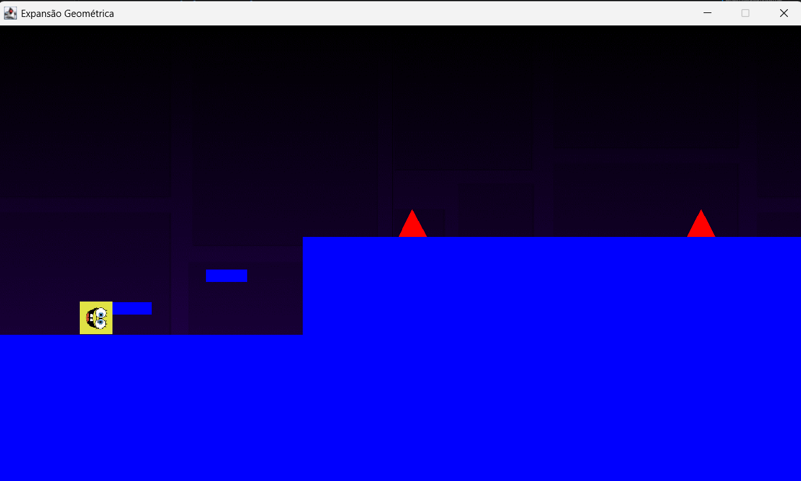

# Geometric Expansion

Geometric Expansion is a 2D platform game developed in Java using Swing as an academic group project.

The project includes multiple playable levels, character movement, collision detection, obstacles, platforms, custom graphical components, background transitions, and optional audio playback.

The original project was developed during college and was later reorganized, cleaned, and documented for portfolio presentation while preserving its original gameplay and core implementation.

## Features

- 2D platform gameplay
- Three playable levels
- Character movement and jumping
- Collision detection
- Platforms and obstacles
- Level selection menu
- Custom Swing components
- Animated background transitions
- Custom fonts and graphical resources
- Optional audio support

## Technologies

- Java
- Java Swing
- AWT
- Java Threads
- Git

The project is currently tested with:

```text
Java 21 LTS

## Screenshots

### Main Menu



### Level Selection



### Gameplay

